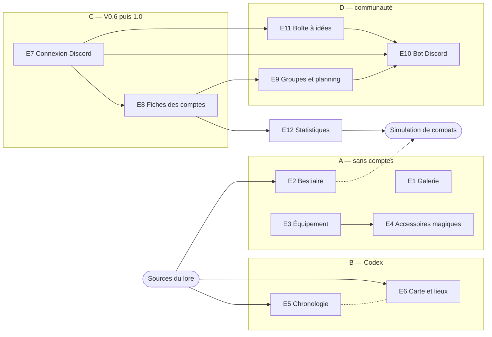

# Feuille de route (vision du propriétaire du projet)

Ce que le site doit devenir, tel que l'a décrit le propriétaire du projet. Cela oriente les choix techniques d'aujourd'hui, même si rien
n'est encore réalisé au-delà de la première étape.

## Étapes

1. **Source rapide et navigable** (en cours) : les règles du jeu et le lore, en pages reliées par mots-clés, importées des classeurs et documents Google
   (les classeurs restent la source de vérité ; les pages et la base sont régénérées à chaque import).
2. **Un outil qui remplace Google Docs/Sheets** (à long terme) : modifier sorts, dons, classes et races depuis le site, avec historique et relecture. À ce moment-là
   la source de vérité bascule : la base devient canonique, les classeurs deviennent une archive en lecture seule. Le moment de la bascule se décide avec le
   propriétaire du contenu ; avant cela, aucune édition n'est faite dans le site (les corrections passent par `tools/sheets/corrections.json`).
   **Premier pas** (demande du propriétaire, 2026-10) : sur le site de dev seulement, les pages du guide, des races, des magies, des classes et des
   métiers se modifient en place (crayon) ; chaque modification est notée au journal (avant / après) et se rapatrie dans `data/rows` par
   `npm run db:appliquer-edition` (`docs/serveur.md`, « Édition »). **Deuxième pas** (2026-10) : la page « Mise à jour » liste ce que la dev change
   par rapport à la production, en note de version historisée, et son bouton apporte les modifications du site dans `data/rows` puis livre en
   production (`docs/serveur.md`, « Mise à jour ») ; le propriétaire a décidé que **le site devient la source** des données qu'il modifie (les
   modifications versées dans `historique_modification`, que les tests relisent pour ne plus épingler ce que le site a changé : `client/src/lib/historique-site.mjs`). Relecture (`brouillon / validé`), auteur (connexion Discord) et accès restreint au bouton restent à faire.
   **API REST et page Debug** (2026-10-15, en place) : sur le site de dev seulement, `/api/v1/` sert chaque élément du jeu rangé dans la base
   (104 ressources en 8 modules, description OpenAPI pour les outils externes) et écrit, par le journal de l'édition, ce que le service sait déjà
   modifier ; la page Debug (menu Outils) montre le système, les performances, les journaux du serveur et le schéma de la base, en quatre menus
   fermés par défaut (son testeur de l'API a été retiré le 2026-10-15, « devenu inutile après le schéma » : [`api.md`](api.md)). Fermée en
   production (décision du propriétaire : la base n'y est ouverte que par le front). **Le CRUD complet reste à étendre domaine par domaine** : armures, boucliers, potions, accessoires, ethnies,
   états, postures, dieux, familiers, créatures… sont en lecture seule tant que le service d'édition ne sait pas les écrire (recette :
   [`api.md`](api.md), « Rendre une ressource modifiable »).
3. **Simulation de combats** (à long terme) : jouer des combats pour juger l'équilibrage des sorts, des classes et des races.

À côté de ces trois étapes, un axe **communauté de jeu** (comptes Discord, groupes, planning, bot, boîte à idées, statistiques) et l'achèvement du
**Codex** et des **Ressources** : voir « Prochaines évolutions » ci-dessous.

## Prochaines évolutions (liste du propriétaire, 2026-10-11)

Le propriétaire a donné ses prochaines évolutions « pêle-mêle » ; elles sont rangées ici par dépendances, avec un identifiant stable (**E1** à **E12**)
pour s'y référer dans les PR et les décisions. **L'ordre des jalons est une proposition**, à valider par le propriétaire ; ce qui attend sa réponse est
regroupé à la fin (« Questions au propriétaire »). Aucune règle du jeu ne se décide ici (valeurs d'objets, tirages, créatures, dates du lore…) : elle vient
d'une source ou d'une décision de [`decisions-regles.md`](decisions-regles.md) (règle d'or).

### Vue d'ensemble

| Id | Évolution | Jalon · version visée | Dépend de | Ce qui existe déjà |
| --- | --- | --- | --- | --- |
| E1 | Galerie : créations humaines / images d'IA | A · V0.3 | — | `/galeries/`, carrousel de l'accueil, `lib/galerie.mjs` (le logo seul) |
| E2 | Page du Bestiaire | A · V0.3, puis B · V0.5 | réponses du propriétaire (`docs/bestiaire.md`) | **premier jet en place** (2026-10-11) : `/bestiaire/`, monstres du « Bestiaire 2.0 » (section 8 bis) et créatures invoquées à part, tableaux filtrables |
| E3 | Refonte de l'équipement et intégration à la fiche | A · V0.4 | la liste des ratés de l'intégration | catalogues de la section 9, bloc équipement de `/fiche/`, tables `personnage_arme`, `personnage_armure_partie`… |
| E4 | Générateur d'accessoires magiques | A · V0.4 | E3 pour les accessoires | tables de tirage `accessoire_emplacement`, `accessoire_propriete`, `accessoire_effet` ; `personnage_accessoire` |
| E5 | Chronologie | B · V0.5 | sources du lore | **premier jet en place** (2026-10-13) : `/chronologie/`, une page par événement daté du Codex et des races, ouverte à droite d'une frise verticale en dégradé, chevrons Haut et Bas ([`chronologie.md`](chronologie.md)) |
| E6 | Carte interactive et lieux | B · V0.5 | image de la carte, sources | type `cartes` (aucune page), entrée « bientôt » du menu Codex |
| E7 | Connexion par Discord seulement : touriste ou joueur, puis rôles | C · V0.6, éprouvée avant la V1.0 | application Discord du propriétaire | tables `utilisateur`, `utilisateur_role` ; « Authentification » plus bas |
| E8 | Fiches de personnage assignées à un compte | C · V0.6 | E7 | `personnage.proprietaire_id`, `personnage_partage`, `v_personnage_visible` |
| E9 | Groupes (OS, HC hors campagne, campagne) et planning des parties | D · V1.2 | E7, E8 | `groupe`, `groupe_membre`, `v_groupe_controle` ; entrées « bientôt » « Groupes d’aventures » (Espace joueur) et « Groupes de jeu » (Espace MJ) du menu |
| E10 | Bot Discord : lien site ↔ serveur, notifications | A · V0.3 (annonces), D · V1.3 | E7 pour les notifications ciblées | — |
| E11 | Boîte à idées, tickets, rapports de bugs | D · V1.1 | E7 | entrée « bientôt » du menu Outils |
| E12 | Statistiques | E · V1.4 | E8 et des fiches réelles | `v_personnage_niveau`, base vivante du service |

Jalons proposés :

- **A — avant la 1.0, sans comptes** : ce qui se fait avec la base actuelle et le mot de passe partagé d'aujourd'hui.
- **B — le Codex** : avant la 1.0 aussi, mais suspendu au rapatriement des sources (salons Discord du lore et des cartes) ; le
  « CODEX Maverick » est importé (2026-10-11, [`codex.md`](codex.md)) : une page `lore/` par divinité, temple ou guilde, civilisation et objet légendaire,
  Codex › Mythologie et Codex › Factions mènent à leurs sommaires ; le « Bestiaire 2.0 » aussi (2026-10-11, [`bestiaire.md`](bestiaire.md)) : Codex › Bestiaire.
- **C — la 1.0** : la connexion par Discord arrive dans la **dernière version 0.x** (V0.6 visée), qui reste en service le temps d'en corriger les bugs ;
  la **V1.0.0** vient quand la connexion est éprouvée et testée et l'ouvre à tout le Discord (précision du propriétaire, 2026-10-11). Le passage en 1.0
  reste son signal ([`flux-git.md`](flux-git.md)). Les fiches liées au compte (E8) sont proposées dans la même V0.6, pour être éprouvées avec la connexion.
- **D — la communauté** : ce que les comptes rendent possible.
- **E — la mesure** : quand il y a assez de fiches réelles ; puis la simulation de combats (étape 3).

Versions visées (proposition, 2026-10-11, depuis la V0.2.0) : chaque livraison `dev` → `master` augmente le deuxième chiffre ([`flux-git.md`](flux-git.md)),
donc **V0.3** est la prochaine livraison. Les numéros sont indicatifs : une livraison faite pour autre chose décale la suite, et la 1.0 reste le signal du
propriétaire.

| Version | Contenu visé |
| --- | --- |
| V0.3 | Galerie humaine / IA (E1), page du Bestiaire des invocations (E2), annonce des versions sur Discord par webhook (E10) |
| V0.4 | Refonte visuelle de l'équipement et de son intégration à la fiche (E3), générateur d'accessoires magiques (E4) |
| V0.5 | Codex, selon l'arrivée des sources : chronologie (E5), carte et lieux (E6), monstres du « Bestiaire 2.0 » (E2) |
| V0.6 | Connexion par Discord : touriste sans connexion, joueur pour les membres du serveur (E7), fiches liées au compte (E8) ; dernière version 0.x, le temps de corriger les bugs |
| V1.0 | La connexion par Discord est éprouvée et testée : ouverture à tout le Discord |
| V1.1 | Boîte à idées, tickets et rapports de bugs (E11) |
| V1.2 | Groupes one-shot (OS), hors campagne (HC) et campagne, planning des parties (E9) |
| V1.3 | Bot Discord : notifications ciblées, rappels de parties, rôles synchronisés (E10) |
| V1.4 | Statistiques des fiches (E12) |
| Ensuite | Remplacer Google Docs/Sheets (étape 2), simulation de combats (étape 3) |

La frise pour les joueurs (une étape par version, à partager sur le Discord) reprend ce tableau.

### E1 — Galerie : distinguer créations humaines et images d'IA (jalon A)

- **But** : chaque image dit clairement son origine, et aucune ne peut être publiée sans.
- **Premier pas** : les entrées de `GALERIE` (`lib/galerie.mjs`) gagnent `origine` (`'humaine'` ou `'ia'`, obligatoire : `test/galerie.test.mjs` refuse
  une entrée sans) et `auteur` (l'artiste, ou l'outil pour une image d'IA) ; une pastille sur chaque image de `/galeries/` et du carrousel de l'accueil
  (« Création humaine » / « Image générée par IA ») et un filtre (toutes, humaines, IA) gardé dans l'adresse, comme sur `/personnages/`.
- **Ensuite (après E7)** : les membres proposent des images (fichier, origine déclarée, auteur) qu'un administrateur valide ; les fichiers vivent dans le
  dossier de données de l'instance (à côté de `db/`, jamais dans git) et une table de la base vivante les décrit (auteur, origine, statut proposée / publiée / refusée).

### E2 — Page du Bestiaire (jalon A, puis B)

- **Déjà là** (premier jet, 2026-10-11, `docs/bestiaire.md`) : `/bestiaire/` (menu Codex › Bestiaire) en deux onglets, chacun un grand tableau avec recherche,
  filtres à cases et tri : les **monstres** du « Bestiaire 2.0 » (copie du propriétaire, migration `0029-bestiaire-monstres` : 144 espèces, 315 cartes, butin,
  échelles de puissance, glossaire) et, à part, les 63 **créatures invoquées** (section 8). Les questions au propriétaire sont dans `docs/bestiaire.md`.
- **Premier pas** : une page `/bestiaire/` et des fiches de créature rendues depuis les tables, sur le modèle des magies, des races et des classes
  (`lib/bestiaire-db.mjs`, `components/bestiaire/`, CSS inséré par le composant), créatures rangées par invocation et par magie, avec renvoi à la magie
  qui les invoque ; mode modification sur le site de dev comme les autres pages typées ; entrée du menu.
- **Ensuite** : les ajustements du propriétaire sur ce premier jet ; le mode modification sur le site de dev ; une fiche par monstre si elle est voulue.
  Le bestiaire prépare la simulation (une créature est un adversaire).

### E3 — Refonte de l'équipement et intégration à la fiche (jalon A)

- **Déjà là** : les catalogues typés (section 9 : armes, armures, boucliers, matériaux, améliorations, pièces élémentaires, accessoires, gemmes, bâtons
  magiques…) ; les pages des Ressources, rendues depuis leur Markdown ; dans `/fiche/`, le bloc équipement (armes, armure, bouclier, accessoires,
  inventaire, objets de départ du métier). Manquent ([`character-generator.md`](character-generator.md)) : les effets d'équipement dans les calculs (AP/AM
  des pièces, bonus des améliorations, résistances des objets). La ceinture a son onglet dans « Équipement » (d'abord une page, 2026-10-15 ; l'onglet « Ceinture »
  depuis le 2026-10-16, décisions R81 et R82 : potions, huiles, carquois et sacs, bâtons magiques ; le bouclier n'y va pas, son emplacement est dans l'armure).
- **Portée** (réponse du propriétaire, 2026-10-11) : une refonte **visuelle** et de l'**intégration à la fiche**, où il y a aujourd'hui des ratés ; les
  règles de l'équipement ne changent pas.
- **Étapes proposées** : (1) les pages des Ressources refaites et rendues depuis les tables (un tableau par catalogue, comme `/metiers/`), modifiables sur
  le site de dev ; (2) la ceinture (en place : l'onglet « Ceinture » de `/ressources/equipement/`, vue `v_objet_ceinture` ; restent la modification sur le site
  de dev, qui doit faire suivre les pages des potions et du bâton ; dans la fiche, le sac selon la Force et la ceinture tirée du sac : décisions R88, R89) ; (3) dans la fiche, les ratés corrigés un par un (chacun relevé avec le propriétaire, chacun son test), le
  choix dans le catalogue et les effets codés en données, un effet à la fois, cité et testé (`lib/fiche-moteur.mjs`) : un effet non codé reste affiché en
  texte et n'est pas compté ; (4) poids, prix et bourse, si les sources les donnent.

### E4 — Générateur d'accessoires magiques (jalon A, après E3 pour les accessoires)

- **Déjà là** : la création d'un accessoire est un tirage écrit dans le classeur et rangé dans la base — emplacement (1d4, `accessoire_emplacement`),
  propriété (1d100 en 8 plages, dont Malédiction de 96 à 100 : `accessoire_propriete`), effet selon la propriété (`accessoire_effet`, gemmes
  `accessoire_effet_gemme`), montures (`accessoire_monture`) ; une fiche garde un accessoire avec sa valeur tirée et sa case « Malédiction » (`personnage_accessoire`).
- **À faire** : un module pur `lib/generateur-accessoire.mjs` qui rejoue ces tables avec un tirage à graine (le même tirage se rejoue, comme prévu pour la
  simulation) et montre chaque jet ; une page (aujourd'hui l'onglet Accessoires de Règles › Équipement) ; « Ajouter à la fiche » vers `personnage_accessoire`. Une ligne vide
  de la source donne « ligne vide dans la source », jamais un effet inventé ; tests contre les tables.

### E5 — Chronologie (jalon B)

- **Déjà là** (premier jet, 2026-10-13, [`chronologie.md`](chronologie.md)) : `/chronologie/` (menu Codex › Chronologie), une page par événement, ouverte à droite
  d'une frise verticale en dégradé (refaite à la demande du propriétaire : la date à gauche de la barre, le titre à droite, chevrons Haut et Bas) ; 74 événements : la liste « Les Impacts mineur et
  majeur » du Codex en entier, les dates des autres pages du Codex (fondations, guerres, objets légendaires…) et des pages de race (apparitions), chacun avec
  les extraits copiés de ses pages sources (tables `evenement`, `evenement_extrait`, migration `0035-chronologie`).
- **Ensuite** : les réponses du propriétaire aux questions de [`chronologie.md`](chronologie.md) (contradictions de dates, règnes, calendrier des mois) ;
  le salon « lore-bestiaire-codex » (export local ou bot, voir [`sources.md`](sources.md)) et le calendrier du monde ; des filtres (époque, peuple, lieu) ;
  la modification sur le site de dev ; les liens vers les lieux (E6).

### E6 — Carte interactive et lieux (jalon B)

- **Prérequis** : l'image (ou les images) de la carte en haute définition et la liste des lieux avec leur description (salon « cartes », non importé).
- **À faire** : une table des lieux (nom, nature — ville, région, donjon… —, position sur la carte, lieu parent, description, sources) ; une page
  Codex › Carte & lieux : carte zoomable (tuiles fabriquées au build depuis l'image), un repère par lieu, sa fiche au clic, une page par lieu pour la
  recherche et les `[[liens]]` ; liens avec la chronologie (E5), le bestiaire (où vit une créature) et le lieu d'origine des fiches ; un outil de placement
  des repères sur le site de dev.
- **Choix technique au prototype** : une bibliothèque de carte embarquée (Leaflet en coordonnées simples, sans fond de carte en ligne) ou un SVG maison ;
  elle doit passer dans la version portable (rien d'externe).

### E7 — Connexion par Discord seulement : touriste ou joueur, puis rôles (jalon C : V0.6, éprouvée avant la 1.0)

La connexion est décidée plus bas (« Authentification : Discord ») ; cette liste y ajoute :

- **Discord uniquement** : ni adresse électronique ni mot de passe ; le mot de passe partagé du site disparaît.
- **Deux statuts d'abord** (réponse du propriétaire, 2026-10-11) : **touriste** — pas connecté, ou connecté sans être membre du serveur Discord —, en
  lecture seule « en surface » (à terme, les rubriques Découvrir et Règles du menu seulement : réponse du propriétaire du 2026-10-18) ; **joueur** — membre du serveur Discord. À chaque connexion, le service vérifie l'appartenance au serveur (portée OAuth
  `guilds.members.read`) ; le bot (E10) la tient à jour entre deux connexions, et qui quitte le serveur redevient touriste.
- **Rôles MJ, éditeur, administrateur** : plus tard (réponse du propriétaire), d'après des rôles Discord à choisir ; une correspondance de configuration
  (identifiant de rôle Discord → `mj`, `editeur`, `admin`) en tirera `utilisateur_role`.
- **Pas de connexion de secours** (réponse du propriétaire) : Discord en panne, le site reste ouvert en touriste, en lecture seule ; c'est le mode dégradé.
  Le compte local que prévoyait la table `utilisateur` (`discord_id` NULL) n'a plus d'usage et se retire à la réalisation.
- **Ce que les rôles ouvriront** : l'édition des règles et le bouton « Effectuer la mise à jour » (sans protection aujourd'hui, décision du propriétaire)
  passent aux rôles `editeur` et `admin` ; l'auteur de chaque modification est inscrit à l'historique ; la relecture `brouillon / validé` devient possible.

### E8 — Fiches de personnage assignées à un compte (jalon C : V0.6)

- **Déjà là** : tout le modèle (fiche de joueur ou prétiré, propriétaire, visibilité privée / MJ / tous, partage à des utilisateurs désignés,
  `v_personnage_visible`), voir « Fiches de personnages » plus bas.
- **À faire** : le service ne lit que les fiches de `v_personnage_visible` et n'écrit que pour leur propriétaire (ou un administrateur) ; « Mes
  personnages » dans l’Espace joueur du menu ; création d'une fiche à son nom ; réglage de la visibilité et du partage ; **assignation** par un administrateur
  ou un MJ (donner à un joueur une copie d'un prétiré, qui reste prétiré, ou lui transférer une fiche existante) ; `/personnages/` ne liste que les fiches visibles.

### E9 — Groupes (OS, HC, campagne) et planning des parties (jalon D)

- **Déjà là** : `groupe` (natures `one_shot` et `campagne`), `groupe_membre` (rôle MJ ou joueur, une fiche inscrite par groupe), la visibilité par groupe.
- **Groupes** : création par un MJ, invitation des joueurs, inscription d'une fiche, page du groupe (membres, fiches inscrites, prochaines parties) ;
  trois natures : one-shot (OS), **hors campagne** (HC : plus court qu'une campagne, plus long qu'un one-shot, comme un chapitre indépendant ou un OAV ;
  réponse du propriétaire, 2026-10-11) et campagne ; la nature `hors_campagne` s'ajoute à `groupe.nature` par une migration, avec E9.
- **Planning** : nouvelles tables de la base vivante — partie (groupe, MJ, début, durée, lieu : vocal Discord ou table réelle, statut proposée / confirmée /
  annulée / jouée), sondage de dates (créneaux proposés, réponses oui / peut-être / non), présence ; calendrier du groupe et de chaque utilisateur,
  abonnement `.ics` (agenda du téléphone) ; rappels par le bot (E10). Instants en UTC dans la base, affichés à l'heure de Paris.

### E10 — Bot Discord : lien entre le site et le serveur (jalon D ; annonces dès A)

- **Notifications générales** (dans un salon) : version livrée et sa note (`/mise-a-jour/`), nouvelles pages, images de la galerie. Premier pas possible
  dès le jalon A par un simple webhook de salon appelé à la livraison, sans bot ni comptes.
- **Notifications ciblées** (après E7, en message privé ou dans le salon d'un groupe) : partie planifiée ou déplacée, rappel la veille, sondage de dates,
  fiche partagée avec soi, inscription dans un groupe, réponse à un ticket ; chacun choisit ce qu'il reçoit.
- **Autres usages** : synchroniser les rôles (E7) ; des commandes (consulter un sort, une fiche, les prochaines parties) ; lire en lecture seule les salons
  du lore pour l'import (option « bot dédié » de [`sources.md`](sources.md), utile à E2, E5 et E6).
- **Architecture proposée** : le service inscrit chaque événement dans une file (table de notifications de la base vivante : événement, destinataire,
  texte, état, essais) que le bot vide ; le site ne dépend jamais du bot (Discord en panne : rien ne bloque). L'API REST de Discord suffit pour écrire, et
  les commandes arrivent en HTTP signé Ed25519, vérifiable avec `node:crypto` : le bot peut rester sans paquet npm, comme le service. Son jeton est un
  secret de l'instance, jamais dans le dépôt ; aucun jeton personnel. Salons et rôles par configuration.

### E11 — Boîte à idées, tickets et rapports de bugs (jalon D)

- **But** : un seul endroit (Outils › Boîte à idée) pour proposer une idée, signaler un bug du site ou une erreur de règle, poser une question.
- **À faire** : tables de la base vivante — ticket (nature idée / bug / règle / question, titre, texte, page concernée, auteur, statut nouveau / accepté /
  en cours / fait / refusé, réponse), commentaires, votes sur les idées ; un bouton « Signaler » sur chaque page (adresse préremplie) ; une vue de tri pour
  les administrateurs ; notifications par le bot (E10).
- **Suite d'un ticket** : un bug accepté peut devenir une *issue* GitHub (le dépôt est privé : le ticket garde le lien, les joueurs ne la voient pas) ; une
  erreur de règle mène à une décision ([`decisions-regles.md`](decisions-regles.md)) ou à une modification sur le site de dev.

### E12 — Statistiques (jalon E ; celles des règles dès A)

- **Des fiches** (après E8, dans la base vivante) : popularité des races, des magies innées et acquises, des classes, des spécialités, des métiers et des
  dieux ; niveau moyen et répartition des niveaux (`v_personnage_niveau`), en tout et par groupe ; calculées par le service, en agrégats seulement (aucune
  fiche privée n'est montrée), page Outils › Statistiques.
- **Des règles** (sans comptes, dès le jalon A) : nombre de sorts par magie et par NPM, classes accessibles par race…, tirés de la base au build.
  Les résistances et faiblesses des combinaisons de deux magies y vont (vue `v_resistance_combinaison`, R85, R86) : « Il seront dans leur onglet
  statistiques après qu'on ai finalisé toute la fiche de personnages. », puis « Non c'est pour la page du site plus tard » (le propriétaire, 2026-10-16).
- **Ensuite** : les statistiques de la simulation de combats (étape 3).

### Ce qui vaut pour chaque évolution

- Une évolution = une ou plusieurs branches `feature/<nom>` vers `dev` ([`flux-git.md`](flux-git.md)), chacune avec ses tests (`client/test/`).
- Tables STRICT et SQL portable. Ce que saisissent les membres (comptes, groupes, parties, tickets, notifications, images proposées) vit dans la **base
  vivante** du service (`db/`), comme les fiches : jamais dans git ni dans `/donnees/maverick.db` ; une table nouvelle y est déclarée au service
  (`TABLES_VIVANTES`, `client/serveur/base-vivante.mjs`) et interdite au journal de l'édition.
- Le contenu du jeu (créatures, événements, lieux, effets d'objets, tirages) vient des sources ou d'une décision du propriétaire, jamais de la vraisemblance.
- Logique pure et testée dans `client/src/lib/`, code du DOM dans `src/scripts/` ; rien de propre à l'hébergement hors de `deploy/`.

### Réponses du propriétaire (2026-10-11)

1. **« HC »** = « hors campagne » : plus court qu'une campagne, plus long qu'un one-shot, comme un chapitre indépendant ou un OAV (E9).
2. **Pas de connexion de secours** : si Discord est en panne, on est déjà en difficulté ; le mode dégradé est l'accès sans connexion, en lecture seule (E7).
3. **Statuts** : touriste si l'on n'est pas connecté ou pas membre du serveur Discord (lecture seule en surface), joueur si l'on en est membre ; les
   autres rôles (MJ, éditeur, administrateur) se verront plus tard (E7).
4. **Équipement** : une refonte visuelle et de l'intégration à la fiche, où il y a aujourd'hui des ratés ; les règles ne changent pas (E3).
5. **Sources** (salons du lore et des cartes, image de la carte, calendrier du monde) : à voir plus tard (E5, E6). Le « CODEX Maverick » et le
   « Bestiaire 2.0 » sont arrivés le 2026-10-11 (copies du propriétaire : [`codex.md`](codex.md), [`bestiaire.md`](bestiaire.md)).

### Réponses du propriétaire (2026-10-15)

1. **Serveur de dev** : il reste, et tout y reste ouvert (le menu « DB » de la page Debug lit toute sa base, fiches et comptes compris ; seule la base
   du serveur de production est fermée) : « Le serveur dev restera. Il servira toujours pour modifier les règles par ceux qui en auront l'accès. »
   Qui y a accès se réglera avec la connexion Discord (E7).
2. **Fiches sur le serveur de dev** : une fiche créée ou supprimée sur le site de dev ne part pas en production (un lot de mise à jour ne porte
   jamais la section 13) ; « on a juste une copie de la prod vers dev après la MEP » — ce que le serveur de test ne fait pas encore (question 7).

### Réponses du propriétaire (2026-10-16)

1. **Provenance des données** : « à terme je compte virer la table famille et origine. Les documents ne seront référencés que pour l'archive mais plus
   besoin de garder les liens de l'origine des données et encore moins à la cellule prêt. C'est bien de le garde pour la construction mais dès la 1.0,
   le lien sera nétoyé » La table `famille`, les colonnes `origine` (152 tables) et `source_ref` (151 tables) servent jusqu'à la 1.0 : importeurs, contrôles
   `--verifier`, rapprochement des classeurs (`docs/sources.md`) et mises à jour depuis les classeurs ; elles sont retirées à la 1.0, les Google Docs et
   Sheets n'étant plus cités que par les archives (`/archives/`). **D'ici là, rien n'est investi dans la provenance** : les références incomplètes relevées
   par le rapprochement (`docs/sql/rapprochement-classeurs.md`) ne sont pas réparées. Ce que le retrait emportera (`note_cellule`, `ecart_source`, les liens
   des pages vers leurs sources, ce que les archives disent des pages qui citent un document) se décidera avec le propriétaire au moment de le faire.

### Réponses du propriétaire (2026-10-18)

Le guide est éclaté (« éclater le guide pour retravailler pleinement l'organisation des onglets et de la présentation », 2026-10-16) : ses pages sont
rangées par le plan du site, `client/src/lib/livres.mjs` (« Découvrir », une page par entrée du menu ; sommaires « Les bases », « Règles avancées »
et « Guide du MJ » : [`content-guide.md`](content-guide.md), « Les pages du guide : rubriques et sommaires »). Les livres lus dans l'ordre (flèches,
glissement du doigt, pagination) sont retirés le même jour (« refaire toutes les anciennes pages du guide. Retirer le mécanisme de swipe, et les flèches
suivant / précédent et la pagination ») ; « Le jeu de rôle, comment ça marche ? » rejoint Bienvenue, les six étapes de la création rejoignent « Créer
son personnage » ; la page Liens gagne la présentation de chaque lien et l'encart « Notre prochaine rencontre IRL » (une annonce modifiable sur le site
de dev, table `annonce`).

1. **Le menu en six rubriques**, dans cet ordre : **Découvrir** (la vitrine, faite pour être vue même des non-membres : Bienvenue, L'univers, Créer son
   personnage, Rejoindre une partie, Liens), **Règles** (Les bases, Races, Magies, Classes, Équipement, Métiers, Artisanat, Règles avancées, Pièces
   élémentaires, Livres & Parchemins), **Espace joueur** (Fiche de personnage, Personnages ; Groupes d'aventures, Table de jeu et Chroniques à venir),
   **Espace MJ** (Guide du MJ ; Fiches de PNJ et scénarios, Groupes de jeu à venir), **Codex**, **Outils**. La rubrique « Ressources » et l'entrée
   « Guide » disparaissent (`client/src/lib/nav.mjs`).
2. **Visibilité** : « Pour l'instant comme les menus ne sont pas prêt rien n'est caché mais tout de même ils ne verront à terme que les 2 premiers
   onglets » ; « Tu fait comme si de rien n'était pour l'instant. On verra les caches. » (sic ; le site n'est utilisé que par deux personnes avant une
   version testable en petit comité). À terme, les non-membres (touristes, E7) ne verront que **Découvrir** et **Règles** ; aujourd'hui, rien n'est
   caché ni filtré, Espace joueur et Espace MJ compris. C'est la réponse à la question ouverte 1 (« Lecture en surface »).
3. **Ressources** : « Composants en Artisanat ok. Pieces élémentaires seront ammenée directement dans armes et armures . Livre et parchemin seront dans
   la partie consommable (ceinture) j'ai oublié de les mentionner. Laisse les visible dans le 2 pour l'instant » (sic) : Composants est sous Règles ›
   Artisanat (`/regles/artisanat/`) ; Pièces élémentaires et Livres & Parchemins restent pour l'instant deux entrées des Règles. **À faire plus tard** : intégrer les Pièces élémentaires
   aux onglets Armes et Armures de l'Équipement, les Livres & Parchemins aux consommables de l'onglet Ceinture.
4. **Liens** (`/decouvrir/liens/`) : « https://discord.gg/GMGBnjzfMk », le serveur Discord « L'univers de Maverick » (déjà cité par les sources de
   « Bienvenue »), et « Maverick JDR sur Tipeee » (https://fr.tipeee.com/maverickjdr), donné par le propriétaire avec son plan du 2026-10-16
   (« un ensemble de liens, sur le discord […] et le https://fr.tipeee.com/maverickjdr »).
5. **Pièges, portes, météo, « Donjon pas bon »** : « dans les règles avancées, pour tout le monde » (groupe « Exploration et voyage » des Règles
   avancées, pas dans l'Espace MJ).
6. **Refaire les pages du guide** : « refaire toutes les anciennes pages du guide. Retirer le mécanisme de swipe, et les flèches suivant / précédent et
   la pagination. Prends chaque nouvelle page depuis le début à recommencer entièrement. Dans la page de bienvenue, retire le sommaire. » Les seize
   pages de Découvrir et des Bases et « Le Mode Hyper et le Mode Super » sont réécrites de zéro d'après la base, les originaux des deux Docs (« Règle du
   jeu/Guide pour MJ - Maverick », « Créer sa fiche de personnage ») et les décisions ; ce qui diffère entre un original et la base est consigné, rien
   n'en est appliqué ([`sql/a-valider.md`](sql/a-valider.md) §6, R83).
7. **Découvrir** : une page par entrée du menu — « Bienvenue absorbe « Le jeu de rôle, comment ça marche » », « L'univers présente race → magie →
   classe », « Créer son personnage = les six étapes sur une seule page », « Rejoindre une partie = une nouvelle page pour les joueurs » ; « les pages
   fusionnées disparaissent, leurs adresses renvoient vers la nouvelle page ». « « Campagne » ou « Scénario one shot » ? » passe dans le Guide du MJ.
8. **Les bases** : « une page par sujet, listées sur un sommaire « Les bases » à /regles/ (comme les Règles avancées) ».
9. **Liens et rencontres** : « Étoffe un peu la présentation pour les liens Discord et Tipeee. Laisse également un encart « Notre prochaine rencontre
   IRL » pour faire la place à une annonce dédiée aux prochaines conventions où Maverick sera présent. » L'encart a un titre fixe et une annonce
   modifiable sur le site de dev (mode modification), qui part en production avec la mise à jour ; vide, il dit « Aucune rencontre annoncée pour le
   moment. » (table `annonce`, migration `0068-annonces`). Il est posé sur la page Liens : la demande se lit aussi pour Bienvenue
   ([`sql/a-valider.md`](sql/a-valider.md) §6, G34).

L'**ordre de lecture** change : l'ancien guide (24 pages) faisait lire la règle du D100 (« Réussir une action ») avant la création du
personnage ; le plan du propriétaire range les règles de base dans Règles › Les bases, dont c'est la première page (`/regles/reussir-une-action/`,
en tête du sommaire `/regles/`), après Découvrir ; « Créer son personnage » renvoie vers elle.

### Questions encore ouvertes

1. **Lecture « en surface »** : quelles pages un touriste voit-il, et lesquelles demandent d'être joueur (E7) ? — *Répondue le 2026-10-18* (ci-dessus) :
   à terme, Découvrir et Règles seulement ; rien n'est caché aujourd'hui.
2. **Ratés de l'équipement** : lesquels, dans la fiche (E3) ?
3. **Fiches existantes** : les fiches Google des joueurs (V15.2.2) sont-elles importées automatiquement ou ressaisies dans `/fiche/` (E8) ?
4. **Visibilité** : tickets (E11) et statistiques (E12) visibles de tous les membres, ou des administrateurs seulement ? Les prétirés et les fiches
   inachevées (celles qui ont des règles à revoir) comptent-ils dans les statistiques ? Les images d'IA passent-elles dans le carrousel de l'accueil (E1) ?
5. **Discord** : un groupe a-t-il son salon ou son rôle, créé par le bot ? Quels salons pour les annonces ? « Chroniques » (Espace joueur du menu) sert-il aux
   comptes rendus des parties jouées (E9, E10) ?
6. **Ordre** : les jalons A à E et les versions visées vous conviennent-ils ?
7. **Copie de la production vers le dev après la mise en production** (réponse 2 ci-dessus, 2026-10-15) : aujourd'hui, le serveur de test
   ne copie la base de la production qu'à sa **première installation** ; ensuite il garde la sienne (`MAVERICK_BASE_TEST=conservee`,
   [`deploy/vps/README.md`](../deploy/vps/README.md)), parce qu'il est réinstallé à chaque version de `dev` et que la copie effacerait les
   modifications des règles en cours. Faut-il recopier la base de la production vers le dev **après chaque mise en production** — toute la
   base, ou seulement les fiches, les comptes et les groupes (section 13), le journal de l'édition du dev gardé ?
8. **« Rejoindre une partie »** — *Répondue le 2026-10-18* : « « Campagne » ou « Scénario one shot » ? » passe dans le Guide du MJ
   (`/mj/campagne-ou-scenario-one-shot/`, son ancienne adresse y renvoie) ; « Rejoindre une partie » est une page nouvelle, pour les joueurs
   (`guide/rejoindre-une-partie`, `/decouvrir/rejoindre-une-partie/`).
9. **Les textes qui décrivaient l'ancien guide d'un seul livre** — *Répondue le 2026-10-18* (« refaire toutes les anciennes pages du guide ») : les pages
   de Découvrir et des Bases sont réécrites ; sur l'accueil, la phrase de la première visite et son bouton ne disent plus que la navigation (« Première
   visite ? Commencez par Découvrir : le jeu, son univers, la création d'un personnage et comment rejoindre une partie. », bouton « Découvrir Maverick ») ;
   la phrase de « Le jeu de rôle, comment ça marche ? » qui renvoyait à « la partie « Progresser » » disparaît avec la fusion de la page dans Bienvenue.
10. **Ordre de lecture** : l'ancien guide, validé par vous, faisait lire la règle du D100 (« Réussir une action ») avant la création du personnage ;
    aujourd'hui, Découvrir présente la création (« Créer son personnage ») avant Les bases, dont « Réussir une action » est la première page, et
    « Créer son personnage » renvoie vers elle. Cet ordre vous convient-il ?

## Orthographe : relecture complète à la conversion en SQL

La relecture générale des coquilles et fautes des classeurs (décision R10 de `docs/decisions-regles.md`) se fait **dans la base**, domaine par domaine, par des migrations de données
(`data/migrations/`) : chacune garde son registre (table, id, colonne, avant, après, nature, raison). Faites : les sorts, les 15 magies et leurs tables dérivées
(`0003-orthographe-magies`, 500 corrections), puis toute la base (`0005-orthographe-base` : 2 247 corrections relues deux fois et 56 noms à clé inchangée, dans toutes les pages et tables typées),
puis les noms (`0006-orthographe-noms` : sens le plus probable, graphie majoritaire d'un nom propre ; les identifiants restent ceux d'origine, aucune table ne dérive plus l'id du nom).
Les points qui demandent une décision du propriétaire sont dans `docs/sql/orthographe-a-valider.md`.
Tant que les classeurs sont la source, **un réimport depuis un classeur réintroduirait ces fautes** : les lignes typées ne se réimportent pas encore (voir `docs/sql/remplissage.md`) ;
au moment de la bascule, la base est la référence. Le registre `tools/sheets/corrections.json` reste en vigueur pour les autres domaines.

## Ce que cela impose dès maintenant

- **Le NAS est temporaire.** Rien de spécifique au NAS en dehors de `deploy/` : le site et l'API doivent tourner dans un conteneur, configurés par variables
  d'environnement ; la mise à jour automatique (`update-site.sh`) est un habillage, pas l'architecture. L'hébergement final reste à choisir ; la solution y sera
  installée pour la 1.0 (décision du propriétaire), par les installateurs autonomes de `deploy/installateur/` (serveur normal et serveur de test, voir `flux-git.md`).
- **La base SQLite est le pivot.** Identifiants stables et jamais réutilisés (une page renommée garde son identifiant), SQL portable (une bascule vers PostgreSQL
  doit rester possible si plusieurs personnes éditent en même temps), modifications historisées (qui, quand, avant/après, état « brouillon / validé »).
- **Les règles sont des données, pas seulement du texte.** (Premier pas : les bonus de niveau de maîtrise des sorts, `sort_bonus_maitrise`, typés quand l'écriture est sans ambiguïté, lisibles par `lib/sort-maitrise.mjs`.) Le texte d'une capacité reste cité tel quel (règle d'or), mais une simulation exige des effets
  structurés (dégâts, durée, cible, jet, état infligé, résistance). On les code progressivement, capacité par capacité, à côté du texte, sans jamais en déduire
  une règle : un effet non codé est absent de la simulation, pas deviné.
- **Le moteur de règles reste pur et sans dépendance** (`client/src/lib/*.mjs`) : le même code sert au site, à l'API, au générateur de fiche et au simulateur.
- **Un site statique ne suffit plus pour l'édition ni pour la simulation** : il faudra un service (API + authentification, rôles lecteur / éditeur) ; le site
  de lecture peut rester statique ou devenir rendu côté serveur selon l'hébergement choisi. Premier pas, préparé avant la 1.0 (demande du propriétaire) :
  le **mode client / serveur** ([`serveur.md`](serveur.md)) — un service Node sans dépendance (`client/serveur/`), livré avec le site et servi par nginx sous
  `/api/`, qui enregistre les prétirés dans la base vivante (`db/`) ; l'authentification s'y ajoutera dans la dernière version 0.x, avant la 1.0.

## Authentification : Discord (décision du propriétaire du projet)

Toute la communauté est sur Discord : la connexion se fait par « Se connecter avec Discord » (OAuth2), personne n'a de compte ni de mot de passe à créer.

- **Ce qu'on garde** : l'identifiant Discord de l'utilisateur (immuable) et son nom d'affichage ; aucun mot de passe, aucun jeton Discord conservé au-delà de la connexion
  (le jeton ne sert qu'à lire l'identité et, au besoin, les rôles sur le serveur). Les modifications de contenu s'attribuent à cet identifiant (historique).
- **Statuts et rôles** : **touriste** (pas connecté, ou pas membre du serveur : lecture seule en surface), **joueur** (membre du serveur), puis MJ (le « groupe
  MJ » à qui un joueur peut ouvrir ses fiches), éditeur, administrateur, d'après des rôles Discord choisis plus tard ; un utilisateur peut cumuler ces rôles
  (table `utilisateur_role`) ; la correspondance rôle Discord → rôle du site est une configuration, pas du code. Quelqu'un qui quitte le serveur redevient
  touriste. **Pas de connexion de secours** (décision du propriétaire, 2026-10-11) : Discord en panne, le site reste lisible en touriste (« Prochaines évolutions », E7).
- **Ce que cela suppose** : un petit service (le site statique seul ne peut pas faire d'OAuth) qui gère la connexion et les sessions (cookie signé, HttpOnly, protection
  CSRF pour les modifications) ; le serveur web protège aussi les pages statiques réservées aux joueurs en lui demandant si la session est valide (`auth_request` avec nginx). L'adresse de
  retour de la connexion dépend de l'adresse publique du site (HTTPS) : elle se configure par variable d'environnement et se change dans le portail développeur Discord
  quand l'hébergement migre.
- **Quand** : dans la dernière version 0.x (V0.6 visée), qui reste en service le temps d'en corriger les bugs ; la **version 1.0** vient quand la connexion
  est éprouvée et testée, et l'ouvre à tout le Discord (décision du propriétaire, précisée le 2026-10-11 ; « Prochaines évolutions », E7). Les serveurs normal
  et de test existent dès la 0.2.0 (voir `flux-git.md`). Le mot de passe partagé d'aujourd'hui reste d'ici là.
  La table des utilisateurs et les colonnes « modifié par » de l'historique se prévoient dès la conception de la base.
- **À faire par le propriétaire le moment venu** : créer l'application dans le portail développeur Discord et fournir son identifiant et son secret comme secrets de
  l'environnement (jamais dans le dépôt). Aucun jeton personnel Discord n'est utilisé.

## Fiches de personnages : joueurs, prétirés, groupes et visibilité (demande du propriétaire)

Les tables sont prêtes dans la base (section 13 de `data/schema.sql`, détail dans `character-generator.md`, « Fiches dans la base »). Les **prétirés**
s'enregistrent dès avant la 1.0 par le service des personnages ([`serveur.md`](serveur.md)) ; les fiches de joueur, le partage et les groupes supposent
la connexion Discord (dernière version 0.x, puis 1.0).

- **Deux sortes de fiches** : celles qu'un joueur crée pour son propre personnage, et les **prétirés**, qui ne sont à personne et que tout le monde voit.
- Une fiche de joueur n'est **visible que de lui seul (et des administrateurs)**. Il peut l'ouvrir à **un ou plusieurs utilisateurs désignés**, à **tous les MJ**
  ou à **tout le monde**.
- **Groupes de jeu** (one-shot ou campagne) : quand un joueur rejoint un groupe et y inscrit son personnage, la fiche devient **automatiquement visible de tous
  les membres du groupe** ; ses fiches inscrites dans d'autres groupes restent cachées par défaut. Un joueur peut avoir plusieurs fiches et être inscrit dans
  plusieurs groupes, mais n'assigne **qu'une fiche par groupe** : en assigner une autre désinscrit automatiquement la précédente.

## Simulation : par où commencer (idée)

Un noyau minimal et vérifiable : un tour de combat (attaque, AP/AM, résistances et vulnérabilités des magies, états), un tirage aléatoire à graine (les
résultats se rejouent), des scénarios décrits en données (équipes, niveaux, sorts), des statistiques sur beaucoup de combats (taux de victoire, dégâts par
tour). On le valide sur des combats dont le propriétaire connaît l'issue avant d'élargir.
